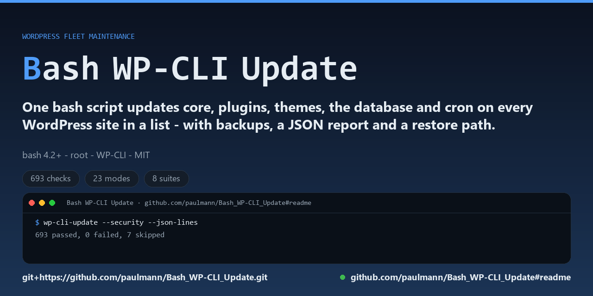

# Bash WP-CLI Update 8.1.0

Maintenance automation for a fleet of WordPress installations, driven by WP-CLI and
written in POSIX-friendly bash 4.2+.

[](https://github.com/paulmann/Bash_WP-CLI_Update/actions/workflows/ci.yml)
[](https://github.com/paulmann/Bash_WP-CLI_Update/releases)
[](LICENSE)
[](https://www.gnu.org/software/bash/)
[](https://www.npmjs.com/package/bash-wp-cli-update)



[**Installation**](#3-install) · [**Quick start**](#4-quick-start) · [**Modes**](#5-modes) · [**Configuration**](#8-configuration) · [**Wiki**](https://github.com/paulmann/Bash_WP-CLI_Update/wiki) · [**Documentation**](docs/README.md) · [**AGENTS.md**](AGENTS.md) · [**Releases**](https://github.com/paulmann/Bash_WP-CLI_Update/releases) · [**Issues**](https://github.com/paulmann/Bash_WP-CLI_Update/issues) · [**Security**](SECURITY.md)

> **For agents.** Start with [AGENTS.md](AGENTS.md): the ordered install, the
> verification order and the absolute do-nots. The
> [wiki](https://github.com/paulmann/Bash_WP-CLI_Update/wiki) carries the same
> material as a manual for a human reader.

One command updates core, plugins, themes, the database schema and cron events on
every site in a list, each one as the system user that owns it, with backups, a
JSON report, a change log and a restore path:

```bash
Bash_WP-CLI_Update.sh --full --backup db --jobs 4 --report /var/log/wp/report.json
```

* Version: **8.1.0** (finder 2.1.0)
* Requires: `bash >= 4.2`, GNU coreutils/findutils, WP-CLI, `root` (to switch into
  site owners), one of `runuser` / `sudo` / `su`
* Optional: `flock`, `timeout` (or `perl`), `tar`, `gzip`, `nice`, `ionice`, `curl`,
  `mail`
* Released under the **MIT** licence — see [LICENSE](LICENSE)

## Contents

- [1. What changed in 8.0.0](#1-what-changed-in-800)
- [2. Safety model](#2-safety-model)
- [3. Install](#3-install)
- [4. Quick start](#4-quick-start)
- [5. Modes](#5-modes)
- [6. Selection and fleet control](#6-selection-and-fleet-control)
- [7. Backups and restore](#7-backups-and-restore)
- [8. Configuration](#8-configuration)
- [9. Output, reports and notifications](#9-output-reports-and-notifications)
- [10. Exit codes](#10-exit-codes)
- [11. Deploying it](#11-deploying-it)
- [12. Tests](#12-tests)
- [13. Upgrading from 6.x](#13-upgrading-from-6x)
- [14. Project layout](#14-project-layout)
- [15. Security: CVE-2026-119977](#15-security-cve-2026-119977)
- [16. License](#16-license)

---

## 1. What changed in 8.0.0

> **8.1.0 makes the tool CVE-aware and moves the licence to MIT.** `--security`
> compares every site's WordPress core version with the fixed releases for
> [CVE-2026-119977](#15-security-cve-2026-119977) and exits 1 when a site needs an
> update — read-only, so it is safe to gate a pipeline on it. `--harden`, the
> `--harden-upgrade-dir` flag and the `HARDEN_UPGRADE_DIR=1` key append a marked deny
> block for `wp-content/upgrade/` to each site's `.htaccess` (Apache/LiteSpeed) and
> print the nginx directive, because nginx ignores `.htaccess`. `--health` gained a
> CVE column, and a core run that leaves a site below the fixed release says so.
> The licence is now MIT, so commercial use no longer needs a separate agreement.

> **8.0.2 is a patch on this release.** A configuration file that set a mode-restricted
> key — `SKIP_IF_NO_UPDATES`, `HOLD_PLUGINS`, `EXCLUDE_THEMES` — made `--doctor`,
> `--check`, `--health` and every list mode exit with a usage error, because those keys
> were validated without asking which mode was running. The recommended production
> profile in §11 sets `SKIP_IF_NO_UPDATES=1`, so a host configured exactly as documented
> could not be diagnosed. The keys are now enforced only when they are typed on the
> command line; from a file they are simply inert for modes that do not use them.
>
> **8.0.1** replaced the `LICENSE` file — which still contained the GNU GPL v3 text
> while the README and the scripts said PolyForm Noncommercial 1.0.0 — with the actual
> PolyForm Noncommercial 1.0.0 text and a copyright line, extended `.gitattributes` to
> the file types 8.0.0 introduced, and rewrote `legacy/README.md` so it names the
> release and the tag each original is frozen at. Upgrading is a file copy, as always.

8.0.0 is the merge of the 5.x/6.x lines of work: the 5.0 monolith in `main`, the
`QWEN_Hybrid` refactor (6.2.0) and the `DeepSeek_Hybrid` refactor (6.1.0). The
three-way comparison, including what was deliberately **not** merged and why, is in
[docs/COMPARISON.md](docs/COMPARISON.md).

Why a major number: the `QWEN-Agent_Mode` branch shipped 7.0.1, a modular tree built
from `src/` fragments. This is a rebuild on the 6.2.0 lineage, not a patch on that tree,
so it does not claim to continue it. That branch keeps its own release and is tagged
`llm/QWEN-Agent_Mode`; nothing was deleted to make room for this version.

Highlights:

| Area | What is new |
|---|---|
| Read-only modes | `--health` (versions, pending updates, database size), `--secrets` (masked scan of `wp-config.php`), `--doctor` (host diagnosis), `--list-backups` |
| Restore | `--restore-db FILE --yes`: the missing half of "we take backups" |
| Fleet control | `--retry N`, `--retry-delay`, `--max-failures` (circuit breaker), `--run-timeout`, `--lock-wait`, `--skip-if-no-updates` |
| Production guards | `--min-free-mb` (refuse to dump onto a full disk), `--nice`, `--ionice`, `--backup-age-days`, `--backup-compress` |
| Observability | `--report FILE` (JSON run report with a change list), `--json-log`, `--notify URL`, `--mail-to`, `--completion bash\|zsh` |
| Policy | `--exclude-themes`, `--hold-plugins`, `--hold-themes` (a pin, not a filter) |
| Multisite | `--url` is derived from `WP_HOME`/`WP_SITEURL` in `wp-config.php`; `--no-url-detect` turns it off |
| Compatibility | 6.1-era config names (`WP_TIMEOUT`, `WP_CLI_BIN`, ...) are accepted with a warning; short forms `-C -T -L -k -u` added |

Everything 6.x did still works: the ten original modes, the `.no_wp_cli` opt-out
marker, the licence handoff that never puts a key in `argv`, data-only configuration,
and the 0/1/2/3/4 exit-code contract.

---

## 2. Safety model

The tool runs as root and changes live sites, so the rules are explicit:

1. **argv, never a string.** Every WP-CLI call is a bash array. Nothing is built by
   string concatenation, nothing goes through `eval`, and `printf %q` is never used.
   The user switch passes arguments as positional parameters, so a path with a quote
   or a space cannot break anything.
2. **Configuration is data.** A config file is parsed as `KEY=VALUE` and is never
   sourced. A line containing a shell metacharacter rejects the whole file (exit 4),
   and a group- or world-writable config file is refused before it is read.
3. **The licence never becomes an argument.** It is written to a temporary file that
   is readable by root and the site owner's group only, the child shell reads it at
   run time, and the file is removed when the call returns. `ps` never shows it.
4. **A backup happens before anything is modified.** A failed backup stops the site
   instead of silently continuing unprotected (`--fail-on never` relaxes that, on
   purpose).
5. **Read-only means read-only.** `--health`, `--secrets`, `--list-plugins`,
   `--verify`, `--list-backups` and `--check` take no backup, take no lock and write
   nothing but log lines.
6. **Destructive modes are two-key.** `--restore-db` needs `--yes`, dumps the current
   database first and runs `wp db check` afterwards.
7. **Exit codes are a contract**, and they are honoured: `2` for a usage error, `4`
   for a config error — not a generic `1`.

---

## 3. Install

Three ways, same result. Pick one:

```bash
# 1. npm (any Linux with node 16+; the package is a delivery channel, the tool is bash)
npm install -g bash-wp-cli-update

# 2. the installer from the archive
curl -LO https://github.com/paulmann/Bash_WP-CLI_Update/releases/latest/download/bash-wp-cli-update-8.1.0.tar.gz
sudo ./install.sh --dry-run     # show every step
sudo ./install.sh --systemd     # does it, plus the nightly timer
```

The npm package installs two commands, `wp-cli-update` and `wp-find`, that exec the same
scripts; it does **not** install WP-CLI, and it does not run anything for you. The tool
still needs root at run time, because it switches into the owner of every site.

```bash
# 3. by hand
sudo apt-get install -y bash coreutils findutils gzip tar
# WP-CLI itself:
curl -o /usr/local/bin/wp https://raw.githubusercontent.com/wp-cli/builds/gh-pages/phar/wp-cli.phar
sudo chmod 755 /usr/local/bin/wp

# the project
sudo git clone https://github.com/paulmann/Bash_WP-CLI_Update.git /opt/wp-cli-update
sudo chmod 755 /opt/wp-cli-update/Bash_WP-CLI_Update.sh
sudo ln -sf /opt/wp-cli-update/Bash_WP-CLI_Update.sh /usr/local/bin/wp-cli-update
sudo ln -sf /opt/wp-cli-update/Find_WP_Senior.sh /usr/local/bin/wp-find

# directories the tool writes to
sudo install -d -m 755 /var/log/wp-cli-update /var/backups/wp-cli-update /var/lib/wp-cli-update

# configuration (root only: it can hold a licence)
sudo install -m 600 /opt/wp-cli-update/wp-cli-update.conf.example /etc/wp-cli-update.conf
sudo editor /etc/wp-cli-update.conf

# build the site list
sudo wp-find --output /var/lib/wp-cli-update/wp-found.txt /var/www /home

# verify before touching anything
sudo wp-cli-update --doctor
sudo wp-cli-update --check
```

`--doctor` answers "why would a run fail before it starts": the wp binary, the user
switch, the tools, the paths, the free space, the config permissions and the policy
in force.

---

## 4. Quick start

```bash
# inventory: what would change, without changing it
wp-cli-update --health

# both spellings work for every option that takes a value
wp-cli-update --full --site=/var/www/example.com --backup=db --dry-run

# one site, dry run first
wp-cli-update --full --site /var/www/example.com --backup db --dry-run
wp-cli-update --full --site /var/www/example.com --backup db

# the whole fleet, four at a time, with a report and a retry
wp-cli-update --full --jobs 4 --backup db --report /var/log/wp-cli-update/run.json --retry 2

# nightly: skip the 90% of sites that are already current
wp-cli-update --full --skip-if-no-updates --backup db --min-free-mb 500 --notify https://hooks.example/ops

# a plugin that must stay pinned
wp-cli-update --plugins --hold-plugins woocommerce,elementor

# restore one database from last night's dump
wp-cli-update --list-backups --site /var/www/example.com
wp-cli-update --restore-db /var/backups/wp-cli-update/example.com/db-20261020-030000.sql --site /var/www/example.com --yes
```

---

## 5. Modes

Exactly one mode per run.

| Mode | Short | What it does | Mutating |
|---|---|---|---|
| `--full` | `-f` | core + plugins + themes + database schema + optimize/repair + cron (+ Astra if licensed) | yes |
| `--core` | `-c` | `core update`, `core update-db --skip-plugins` | yes |
| `--plugins` | `-p` | update all plugins, or the enumerated set with `--only-active`/`--exclude-plugins`/`--hold-plugins` | yes |
| `--themes` | `-t` | update all themes, or the enumerated set with `--exclude-themes`/`--hold-themes` | yes |
| `--db-optimize` | `-d` | `db optimize` then `db repair` | yes |
| `--db-fix` | `-x` | `db repair` | yes |
| `--cron` | `-r` | `cron event run --due-now` | yes |
| `--astra` | `-s` | Astra add-on update, activating the licence if needed | yes |
| `--list-plugins` | `-l` | plugin inventory as table, JSON, CSV or TSV | no |
| `--plugin-manage` | `-m` | activate / deactivate / delete one plugin (delete needs `--yes` or a terminal) | yes |
| `--verify` | | `core verify-checksums` and `plugin verify-checksums --all` | no |
| `--health` | | core version, pending plugin/theme updates, database size | no |
| `--secrets` | | secret constants in `wp-config.php` by name, permissions, stale copies | no |
| `--security` | | CVE-2026-119977 assessment: core version against the fixed releases; exit 1 when a site needs an update | no |
| `--list-backups` | | backup files per site, newest first | no |
| `--restore-db FILE` | | import FILE into the database (needs `--yes`) | yes |
| `--harden` | | append the `wp-content/upgrade/` deny block to each site's `.htaccess` and print the nginx directive | yes |
| `--check` | | environment plus every site in the list, changes nothing | no |
| `--status` | | last run summary and log sizes | no |
| `--doctor` | | host diagnosis, no site list needed | no |
| `--completion SHELL` | | print a bash or zsh completion script | no |
| `--list-sites` | | the resolved site list and exit | no |
| `--list-modes` | | mode names, one per line (for shell completion) | no |

---

## 6. Selection and fleet control

| Option | Meaning |
|---|---|
| `-S, --site PATH` | operate on one site, overrides the site list |
| `--sites FILE` | site list, one absolute path per line (default: `<script dir>/wp-found.txt`) |
| `--max-sites N` | process at most N sites (0 = all) |
| `-j, --jobs N` | process N sites per batch (1 = sequential) |
| `-u, --user NAME` | force the system user for every site |
| `--default-user NAME` | fall back to NAME when ownership cannot be determined |
| `-U, --url URL` | pass `--url` to every call (multisite); otherwise derived from `wp-config.php` |
| `--no-url-detect` | never derive `--url` |
| `--retry N` | re-run a failed site up to N extra times |
| `--retry-delay SEC` | wait between attempts (default 15) |
| `--max-failures N` | stop the fleet after N failed sites (0 = never) |
| `--run-timeout SEC` | total time budget; the rest of the fleet is skipped, not failed silently |
| `--lock-wait SEC` | wait for another run's lock instead of failing at once |
| `--skip-if-no-updates` | skip sites whose core, plugins and themes are current (`--core/--plugins/--themes/--full`) |

A **retry** is worth it for a timed-out download or a busy database lock; it is not
worth it for a wrong `--url`. That is why the default is 0 and the operator decides.

The **circuit breaker** exists because a fleet-wide failure (a broken WP-CLI, a full
disk, a network outage) should stop the run instead of writing the same error 200
times. `--max-failures 5` is a sane production value.

---

## 7. Backups and restore

| Option | Meaning |
|---|---|
| `-b, --backup MODE` | `off` (default), `db` (`wp db export`), `full` (`tar.gz` of the tree) |
| `--no-backup` | never back up, including before a plugin delete |
| `-B, --backup-dir DIR` | where backups go (default `<script dir>/backups`) |
| `--keep-backups N` | backups kept per site (default 3, 0 = keep everything) |
| `--backup-age-days N` | also drop backups older than N days |
| `--backup-compress` | gzip a database dump after export |
| `--min-free-mb N` | refuse to write a dump when free space is below N MiB |

Layout: `<backup dir>/<site directory name>/db-YYYYmmdd-HHMMSS-PID.sql[.gz]`,
`site-...tar.gz`, `plugin-<slug>-...tar.gz`. The backup tree is created `0700` and stays
root-only: `wp db export` runs as the site owner after the user switch, so the dump is
written into a private temporary directory owned by that user and then moved into place
by root, which sets `root:root 0640`. The permissions of the backup tree therefore do not
matter; if the move cannot be made, the dump is left where it is and the full path is
logged — nothing is deleted.

Restore is intentionally awkward:

```bash
wp-cli-update --restore-db /path/db-20261020-030000.sql --site /var/www/example.com --yes
```

It refuses without `--yes`, dumps the current database first, imports, then runs
`wp db check` and reports the result.

---

## 8. Configuration

Precedence, lowest to highest:

```text
built-in defaults  <  /etc/wp-cli-update.conf  <  <script dir>/wp-cli-update.conf
                   <  WP_CLI_UPDATE_<KEY> environment  <  command line
```

`--config FILE` reads one file instead of the two defaults. `--print-config` prints
every effective value with the layer that produced it.

The complete annotated example is [wp-cli-update.conf.example](wp-cli-update.conf.example).
The keys:

| Key | Default | Meaning |
|---|---|---|
| `WP_CLI_PATH` | `/usr/local/bin/wp` | the wp binary |
| `SITES_FILE` | `<script dir>/wp-found.txt` | site list |
| `DISCOVER_SCRIPT` | `<script dir>/Find_WP_Senior.sh` | finder |
| `AUTO_DISCOVER` | `1` | run the finder when the list is missing (0 on production hosts) |
| `MAX_SITES` | `0` | cap per run |
| `SKIP_PLUGINS` | empty | `--skip-plugins` value for plugin/theme operations |
| `SKIP_PLUGINS_FOR_LISTING` | `0` | also pass it to listing commands |
| `LOG_FILE`, `ERROR_LOG_FILE` | `<script dir>/*.log` | logs |
| `LOG_MAX_BYTES`, `LOG_KEEP` | `5242880`, `3` | rotation |
| `LOG_LEVEL` | `info` | `debug|info|warn|error` |
| `LOG_JSON` | `0` | one JSON object per log line |
| `ERROR_OUTPUT_LINES` | `20` | failing-output lines kept |
| `COLOR` | `auto` | `auto|always|never` |
| `LOCK_FILE`, `LOCK_WAIT` | `<script dir>/.wp-cli-update.lock`, `0` | locking |
| `TIMEOUT`, `TIMEOUT_SIGNAL`, `KILL_AFTER` | `0`, `TERM`, `30` | per-command timeout |
| `ALLOW_ROOT` | `auto` | `--allow-root` policy |
| `FAIL_ON` | `any` | `any|all|never` |
| `STRICT` | `0` | a warning makes the run a failure |
| `DRY_RUN` | `0` | make dry-run the default on a host |
| `JOBS` | `1` | batch size |
| `RETRY`, `RETRY_DELAY` | `0`, `15` | retries |
| `MAX_FAILURES` | `0` | circuit breaker |
| `RUN_TIMEOUT` | `0` | total budget |
| `NICE_LEVEL`, `IONICE_CLASS` | `10`, `none` | do not starve the web server |
| `BACKUP`, `BACKUP_DIR`, `KEEP_BACKUPS` | `off`, `<script dir>/backups`, `3` | backups |
| `BACKUP_AGE_DAYS`, `BACKUP_COMPRESS` | `0`, `0` | retention and compression |
| `MIN_FREE_MB` | `0` | disk guard |
| `HARDEN_UPGRADE_DIR` | `0` | add the `wp-content/upgrade/` deny block to `.htaccess` before updating |
| `ONLY_ACTIVE` | `0` | update only active plugins with updates |
| `EXCLUDE_PLUGINS`, `EXCLUDE_THEMES` | empty | leave out of `--plugins`/`--themes`/`--full` |
| `HOLD_PLUGINS`, `HOLD_THEMES` | empty | pinned; never updated, always logged |
| `ASTRA_SLUG` | `astra-addon` | Astra add-on slug |
| `LICENCE` | empty | Astra licence (prefer `WP_CLI_UPDATE_LICENCE` or a key file) |
| `URL` | empty | forced `--url` |
| `URL_DETECT` | `1` | derive `--url` from `wp-config.php` |
| `USER_ENV` | empty | variable names passed through to the child |
| `DEFAULT_USER` | empty | fallback system user |
| `NO_USER_SWITCH` | `0` | run as the invoking user |
| `NOTIFY_WEBHOOK`, `NOTIFY_ON`, `NOTIFY_TIMEOUT` | empty, `failure`, `10` | webhook |
| `MAIL_TO` | empty | mail the summary |
| `REPORT_FILE` | empty | JSON run report |
| `SKIP_IF_NO_UPDATES` | `0` | ask before acting |
| `WP_GLOBAL_ARGS` | empty | extra global flags for wp (for example `--skip-themes`) |

Legacy 6.1 names are accepted with a warning: `WP_TIMEOUT` → `TIMEOUT`,
`WP_CLI_BIN` → `WP_CLI_PATH`, `SITE_URL` → `URL`, `BACKUP_KEEP` → `KEEP_BACKUPS`,
`DEFAULT_JOBS` → `JOBS`.

---

## 9. Output, reports and notifications

* **Data** goes to stdout in every machine-readable format (`table` included, so a
  table can be piped and diffed). Progress, warnings, the banner and the summary go
  to **stderr**, so `--list-plugins --format json | jq` and `--format csv > plugins.csv`
  see nothing but the payload. In `table` mode the rows are the data and the prose is
  on stderr; `--json-lines` follows the same rule.
* `--json-lines` emits one object per site plus a summary object.
* `--report FILE` writes one JSON document:

```json
{"run":{"version":"8.0.0","mode":"full","dry_run":false,"host":"web01","duration_s":412,
        "sites_total":42,"sites_ok":41,"sites_failed":1,"sites_skipped":0,
        "ops_ok":180,"ops_failed":1,"warnings":0,"retries":1,"changes":6,"exit":1},
 "sites":[{"path":"/var/www/a","status":"OK"},{"path":"/var/www/b","status":"FAILED"}],
 "changes":[{"site":"/var/www/a","kind":"plugin","name":"jetpack","from":"13.0","to":"13.5"}]}
```

* `--notify URL` POSTs a small JSON summary when the run matches `--notify-on`
  (`never|failure|always`); `--mail-to` sends the same payload through `mail(1)`.
  The payload carries counters only: no site content, no licence, no paths.

---

## 10. Exit codes

| Code | Meaning |
|---|---|
| 0 | success (`--fail-on any`: every operation on every site succeeded) |
| 1 | operational error (at least one WP-CLI operation or site failed) |
| 2 | usage error (bad command line) |
| 3 | environment error (bash too old, wp-cli missing, lock held, not root) |
| 4 | configuration error (unreadable or rejected config file) |
| 130 / 143 / 131 | interrupted (SIGINT / SIGTERM / SIGHUP); a partial summary is still printed and the JSON report is still written |

`--security` uses the same contract for a different question: exit 1 means at least one
site is below the fixed release for CVE-2026-119977 or its core version could not be
read; exit 0 means every site is safe. It is read-only, so it can gate a pipeline or run
from monitoring without taking the lock.

---

## 11. Deploying it

`contrib/` holds what a real host needs:

* `install.sh` — the same steps performed in order, idempotent, with `--dry-run` and
  `--uninstall`; `sudo ./install.sh --systemd` also installs the timer;
* `contrib/wp-cli-update.service` and `.timer` — a nightly systemd run with a log;
* `contrib/cron.example` — the same with plain cron;
* `contrib/logrotate.conf` — rotation for the log directory.

Recommended production profile (the paths are the ones §3 creates; without them the
built-in defaults point at the script directory, and a scheduled run would look for a
site list that is not there — exit 3):

```ini
# /etc/wp-cli-update.conf
WP_CLI_PATH=/usr/local/bin/wp
SITES_FILE=/var/lib/wp-cli-update/wp-found.txt
LOG_FILE=/var/log/wp-cli-update/manager.log
ERROR_LOG_FILE=/var/log/wp-cli-update/errors.log
BACKUP_DIR=/var/backups/wp-cli-update
AUTO_DISCOVER=0
JOBS=4
BACKUP=db
KEEP_BACKUPS=5
BACKUP_AGE_DAYS=14
BACKUP_COMPRESS=1
MIN_FREE_MB=500
NICE_LEVEL=10
IONICE_CLASS=idle
TIMEOUT=600
RETRY=2
RETRY_DELAY=30
MAX_FAILURES=5
SKIP_IF_NO_UPDATES=1
HARDEN_UPGRADE_DIR=1
FAIL_ON=any
REPORT_FILE=/var/log/wp-cli-update/last-run.json
LOG_JSON=1
```

Run `--health` from monitoring (it is read-only and lock-free), and `--check` after
any change to the config.

---

## 12. Tests

The suite needs no root, no WordPress, no network and no WP-CLI: it builds synthetic
site trees and a stub `wp` that records its own argv.

```bash
bash tests/run_tests.sh            # every suite
bash tests/run_tests.sh v7         # one suite
TEST_SITE_USER=www-data bash tests/run_tests.sh
```

| Suite | Covers |
|---|---|
| `test_static.sh` | syntax, shellcheck, CRLF, permissions, banned constructs, version consistency |
| `test_base_contract.sh` | the public surface of the original scripts (modes, options, exit codes, opt-out marker, scope) |
| `test_finder.sh` | `Find_WP_Senior.sh`: discovery, JSON, depth, exclusions |
| `test_manager.sh` | every mode, argv shape, listing formats, config layers |
| `test_fleet.sh` | parallelism, counters, JSON Lines, config security |
| `test_secretguard.sh` | `tools/scan-secrets.sh` |
| `test_v7.sh` | read-only modes, restore, retries, circuit breaker, guards, report, policy lists, config aliases |
| `test_cve.sh` | `--security` verdicts and exit codes, `--harden` idempotence and backup, `--harden-upgrade-dir`/`HARDEN_UPGRADE_DIR`, nginx notice, absence of writes in read-only modes |

Checks that need root or a switchable account report `SKIP` with the reason instead of
`FAIL`, so the same suite is usable on a laptop and on the server.

The suite is meant to run as **root** (or inside `unshare -r`, which gives uid 0 in a
private namespace without touching the host). That is the product's own contract: the
manager refuses to run without root, so a plain non-root account cannot exercise the
exit-code paths. Measured results:

| Environment | Result |
|---|---|
| Debian 12, `unshare -r` (uid 0, no switchable account) | 693 passed, 0 failed, 7 skipped |
| Windows host, Git Bash, non-root | 0 failures outside the root-only checks; `chmod`, `ionice` and user-switch checks skip |
| Plain non-root account | the user-switch checks in `test_manager.sh` fail with exit 3, which is the manager refusing to run |

---

## 13. Upgrading from 6.x

1. Back up the current script and config.
2. Replace the script; keep `/etc/wp-cli-update.conf`. Legacy keys keep working and
   are reported once (`WP_TIMEOUT` is the 6.1 name for `TIMEOUT`).
3. `--print-config` and diff it against your expectations before the first run.
4. `--doctor` and `--check` before the first real run.
5. Nothing in 6.x was removed. `--backup`, `--json-lines`, `--only-active`,
   `--exclude-plugins`, `--fail-on`, `--strict`, `--allow-root` all behave as before.

---

## 14. Project layout

```text
Bash_WP-CLI_Update.sh        the manager (this is the product)
Find_WP_Senior.sh            the site finder
wp-cli-update.conf.example   annotated configuration reference
tests/                       behavioural suites plus a stub wp
tools/scan-secrets.sh        standalone secret scanner over a tree
contrib/                     systemd unit, timer, cron example, logrotate
docs/                        operator and agent documents (see docs/README.md)
wiki/                        GitHub wiki sources and manifest
assets/                      the social preview rendered by ghagent
community files              CODE_OF_CONDUCT.md, SUPPORT.md, CITATION.cff,
                             .github/ (issue forms, PR template, CODEOWNERS,
                             dependabot, workflows)
AGENTS.md                    install-and-configure instructions for an LLM agent
AGENT.md                     pointer to AGENTS.md
CHANGELOG.md                 release history
PROJECT_MAP.md               file map
```

## 15. Security: CVE-2026-119977

WordPress core 4.7 through 7.1.3 contains a race condition in the core update
mechanism: while a site is updating, an unauthenticated attacker can execute code on
the server. CVSS 8.1; added to CISA KEV on 2026-11-03; mass scanning observed. Fixed
releases: 7.1.4 (recommended), 7.0.8 on the 7.0 branch, 6.9.11 on the 6.9 branch and
4.7.39 on the 4.7 branch. 4.6 and older receive no fix: upgrade to 7.1.4 or retire the
site.

The tool answers both halves of the response: which sites are exposed, and how to close
the upgrade directory while they are updated.

```bash
# read-only: per-site verdict; exit 1 when any site needs an update
wp-cli-update --security --json-lines

# update the fleet, back up first, and harden each site in the same pass
wp-cli-update --full -j 4 --backup db --harden-upgrade-dir \
  --report /var/log/wp-cli-update/cve-run.json

# verify that the versions really moved
wp-cli-update --security --json-lines
```

`--harden` (or `HARDEN_UPGRADE_DIR=1` in the configuration) appends a marked block to
each site's root `.htaccess`:

```apache
<IfModule mod_rewrite.c>
    RewriteEngine On
    RewriteRule ^wp-content/upgrade/ - [F,L]
</IfModule>
```

The block is idempotent, an existing `.htaccess` is copied once to
`.htaccess.wp-cli-update.bak` before the first change, and Apache and LiteSpeed honour
it. A core run that leaves a site below the fixed release says so, and `--security`
keeps exiting 1, so a half-finished fleet cannot look done.

**nginx does not read `.htaccess`.** On an nginx host add this to every `server` block:

```nginx
location ^~ /wp-content/upgrade/ { deny all; }
```

The tool prints that directive at the end of a hardening run; it never edits a server
configuration itself.

### Agent prompt

Hand this to an AI agent that has shell access to the host:

```text
You are responding to WordPress CVE-2026-119977: a race condition in the core update
mechanism affecting WordPress core 4.7 through 7.1.3 (CVSS 8.1, CISA KEV since
2026-11-03). Use Bash WP-CLI Update on this host; do not improvise with ad-hoc wp calls.

1. Assess, read-only: wp-cli-update --security --json-lines
2. Back up before changing anything: the run below dumps each database first
   (--backup db) and refuses to update a site whose dump failed.
3. Update the exposed sites to the fixed release for their branch: 7.1.4, or 7.0.8 on
   the 7.0 branch, 6.9.11 on the 6.9 branch, 4.7.39 on the 4.7 branch; 4.6 and older
   must go to 7.1.4. Use:
   wp-cli-update --full -j 4 --backup db --harden-upgrade-dir --report /var/log/wp-cli-update/cve-run.json
4. Verify: run wp-cli-update --security --json-lines again and require exit 0; the core
   version of every updated site must have changed.
5. If nginx serves the sites, add "location ^~ /wp-content/upgrade/ { deny all; }" to
   every server block; .htaccess does nothing there.
6. Report the before and after version per site, the sites that still need an update,
   the .htaccess backup paths, and the nginx change you made. Do not call a site patched
   without the --security verdict.
```

The wiki has the long-form runbook:
[Security: CVE-2026-119977](https://github.com/paulmann/Bash_WP-CLI_Update/wiki/09-Security-CVE-2026-119977).

## 16. License

MIT — see [LICENSE](LICENSE). Use, modification, distribution and commercial use are
permitted under the MIT terms; the software is provided "as is", without warranty.
